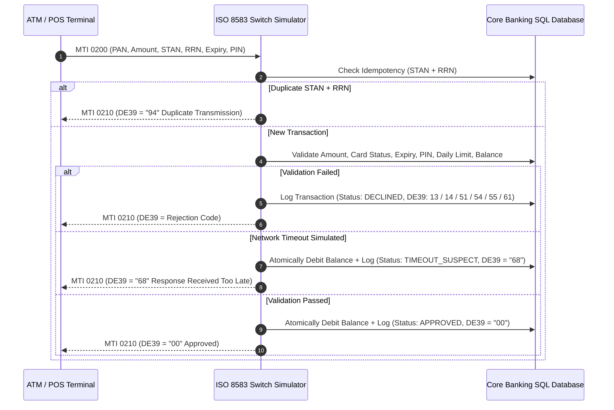
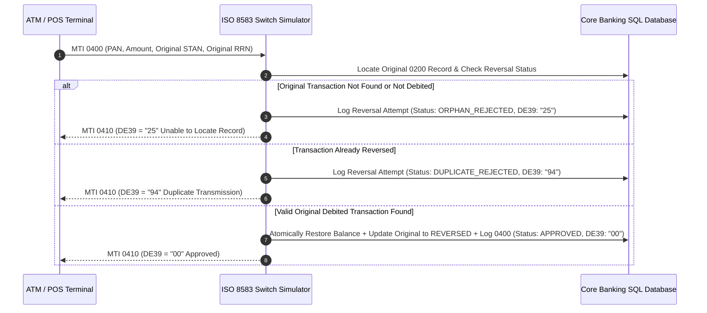

# ISO 8583 Payment Switching Simulator & Automated QA Testing Suite

A high-performance, lightweight **Payment Switching Simulator and Automated QA Testing Suite** built to demonstrate Quality Assurance engineering expertise in the banking and payment transaction domain.

This suite simulates core payment switching operations adhering to the **ISO 8583 standard**, executing financial authorization requests (`0200 -> 0210`), network timeout handling (`68`), automated reversal processing (`0400 -> 0410`), idempotency protection (`94`), and end-of-day general ledger SQL reconciliation.

---

## Key Features

- **ISO 8583 Financial Switching Simulator (`0200 -> 0210`)**: Validates card status, expiration date (`YYMM`), customer PIN, single/cumulative daily transaction limits, and account balances before executing atomic debits.
- **Timeout & Auto-Reversal Engine (`0400 -> 0410`)**: Accurately simulates network dropouts where transactions enter a `TIMEOUT_SUSPECT` state with response code `68`. Provides an automated reversal processor that validates the original transaction, restores 100% of the customer's balance, and updates audit records to `REVERSED`.
- **Idempotency & Concurrency Protection (`94`, `25`)**: Guarantees zero double-debiting under high concurrency and sequential replay attacks using trace number matching (`STAN` and `RRN`). Rejects orphan reversals that have no matching original debited transaction.
- **Automated QA Test Suite (22 Scenarios, 100% Pass Rate)**: Comprehensive test suite covering Positive (Happy Path), Negative (Declines), Timeout/Reversal, and Multithreaded Race-Condition categories.
- **Production SQL QA & Reconciliation Scripts**: Standalone `.sql` audit scripts used by Payment QA and Application Support engineers to detect double debits, find orphan reversals, audit unsettled timeouts, and execute daily ledger reconciliation.
- **Zero External Dependencies**: Built entirely using Python 3's standard library (`sqlite3`, `unittest`, `http.server`, `threading`). Runs instantly on any system without `pip install`.

---

## Payment Switching Architecture & Flows

### 1. Financial Transaction Flow (`MTI 0200 -> 0210`)



### 2. Auto-Reversal Flow (`MTI 0400 -> 0410`)



---

## ISO 8583 Specification Reference

### Message Type Identifiers (MTI)

| MTI | Description | Direction |
| :--- | :--- | :--- |
| `0200` | Financial Transaction Request (Purchase / ATM Withdrawal / Inquiry) | Terminal -> Switch |
| `0210` | Financial Transaction Response | Switch -> Terminal |
| `0400` | Reversal Request (Auto-reversal on timeout / void) | Terminal -> Switch |
| `0410` | Reversal Response | Switch -> Terminal |

### Common Data Elements (DE) Used

| Field | Data Element (DE) Name | Description |
| :--- | :--- | :--- |
| `DE 2` | Primary Account Number (PAN) | Card number (e.g., `4000123456780001`) |
| `DE 3` | Processing Code | `000000` (Purchase), `010000` (Withdrawal), `300000` (Inquiry) |
| `DE 4` | Amount, Transaction | Transaction value in smallest currency units |
| `DE 11` | Systems Trace Audit Number (STAN) | 6-digit unique terminal trace sequence number |
| `DE 14` | Date, Expiration | Card expiration date in `YYMM` format |
| `DE 37` | Retrieval Reference Number (RRN) | 12-character transaction reference identifier |
| `DE 39` | Response Code | 2-digit status code returned by the switch |
| `DE 41` | Card Acceptor Terminal ID | Terminal identification code (e.g., `POS_MART_1`) |
| `DE 52` | Personal Identification Number (PIN) | Customer card PIN |

### ISO 8583 Response Codes (DE 39)

| DE 39 | Meaning | Description |
| :---: | :--- | :--- |
| **`00`** | Approved | Transaction completed and settled successfully |
| **`13`** | Invalid Amount | Amount is zero, negative, or formatted incorrectly |
| **`14`** | Invalid Card Number | Card PAN not registered or card is inactive |
| **`25`** | Unable to Locate Record | Reversal target does not exist or original was not debited |
| **`51`** | Insufficient Funds | Account balance is less than requested amount |
| **`54`** | Expired Card | Card expiration date has passed or doesn't match record |
| **`55`** | Incorrect PIN | PIN verification mismatch |
| **`61`** | Exceeds Limit | Single or cumulative transaction exceeds daily limit |
| **`68`** | Response Received Too Late | Network timeout simulated; balance debited in suspect state |
| **`94`** | Duplicate Transmission | Request rejected due to identical STAN and RRN collision |
| **`96`** | System Error | Unexpected server error or invalid protocol message |

---

## Repository Structure

```text
iso8583-payment-qa-suite/
├── src/
│   ├── __init__.py
│   ├── database.py              # SQLite schema, seed data, and atomic locking
│   ├── iso8583_models.py        # ISO 8583 data models, MTI, and DE 39 constants
│   ├── payment_switch.py        # Core ISO 8583 switching and reversal engine
│   └── server.py                # HTTP REST JSON wrapper (POST /iso8583/transaction)
├── tests/
│   ├── __init__.py
│   ├── base_test.py             # Shared QA fixture & SQL balance assertion helpers
│   ├── test_01_positive_scenarios.py       # POS, ATM, multi-tx, and HTTP tests
│   ├── test_02_negative_scenarios.py       # Funds, PIN, expiry, limit, and card checks
│   ├── test_03_timeout_and_reversal.py     # Timeout (68), auto-reversal, orphan guards
│   └── test_04_idempotency_and_concurrency.py # Duplicate burst, race condition, SQL audits
├── sql/
│   ├── 01_detect_double_debits.sql         # Audit query for duplicate debits
│   ├── 02_find_orphan_reversals.sql        # Audit query for orphan reversal requests
│   ├── 03_audit_unsettled_timeouts.sql     # Audit query for unresolved suspect transactions
│   └── 04_daily_ledger_reconciliation.sql  # Daily reconciliation: balance vs debits/refunds
├── scripts/
│   └── run_sql_audits.py        # CLI tool simulating transactions & printing SQL reports
├── docs/
│   └── SIT_TEST_CASE_MATRIX.md  # Comprehensive 22-case System Integration Test Matrix
├── .gitignore
└── README.md
```

---

## Quickstart & Execution

This project requires **Python 3.8+** and uses standard library modules only.

### 1. Run the Automated QA Test Suite

To run all 22 automated test scenarios:

```bash
python -m unittest discover -s tests -v
```

Output:
```text
test_SIT_POS_001_valid_pos_purchase ... ok
test_SIT_POS_002_valid_atm_cash_withdrawal ... ok
test_SIT_POS_003_sequential_transactions_ledger_integrity ... ok
test_SIT_POS_004_balance_inquiry ... ok
test_SIT_POS_005_http_endpoint_transaction ... ok
test_SIT_NEG_001_insufficient_funds ... ok
test_SIT_NEG_002_incorrect_pin ... ok
test_SIT_NEG_003_expired_card ... ok
test_SIT_NEG_004_expiry_date_mismatch ... ok
test_SIT_NEG_005_invalid_amount_zero_or_negative ... ok
test_SIT_NEG_006_exceeds_daily_limit_single_tx ... ok
test_SIT_NEG_007_exceeds_daily_limit_cumulative ... ok
test_SIT_NEG_008_unregistered_card_pan ... ok
test_SIT_REV_001_timeout_and_auto_reversal ... ok
test_SIT_REV_002_orphan_reversal_rejected ... ok
test_SIT_REV_003_reversal_of_declined_transaction_rejected ... ok
test_SIT_REV_004_duplicate_reversal_rejected ... ok
test_SIT_REV_005_approved_transaction_manual_reversal ... ok
test_SIT_IDM_001_sequential_duplicate_transaction ... ok
test_SIT_IDM_002_concurrent_duplicate_burst ... ok
test_SIT_IDM_003_concurrent_balance_exhaustion_no_overdraft ... ok
test_SIT_IDM_004_sql_audit_and_reconciliation_scripts ... ok

----------------------------------------------------------------------
Ran 22 tests in 0.664s

OK
```

Alternatively, if `pytest` is installed in your environment:
```bash
pytest -v
```

---

### 2. Run the SQL QA & Reconciliation Audit Runner

Simulates a day of payment switching operations (including normal purchases, cash withdrawals, timeouts, duplicate transmissions, and orphan reversal attempts) and runs the 4 SQL audit queries:

```bash
python scripts/run_sql_audits.py
```

Sample audit output:
```text
==========================================================================================
 AUDIT 1: DOUBLE-DEBIT ANOMALY DETECTION (01_detect_double_debits.sql)
==========================================================================================
  [STATUS: OK] No double debits detected. Idempotency protection fully intact.

==========================================================================================
 AUDIT 2: ORPHAN REVERSALS AUDIT (02_find_orphan_reversals.sql)
==========================================================================================
reversal_tx_id       | reversal_mti         | pan                  | amount               | stan                 | rrn                  | reversal_rc          | reversal_status     
------------------------------------------------------------------------------------------------------------------------------------------------------------------------------------
6                    | 0400                 | 4000123456780002     | 50000                | 999001               | 999001999001         | 25                   | ORPHAN_REJECTED     

==========================================================================================
 AUDIT 3: UNSETTLED TIMEOUT / SUSPECT TRANSACTIONS (03_audit_unsettled_timeouts.sql)
==========================================================================================
suspect_tx_id        | pan                  | processing_code      | amount               | stan                 | rrn                  | response_code        | status              
------------------------------------------------------------------------------------------------------------------------------------------------------------------------------------
7                    | 4000123456780004     | 000000               | 45000                | 100004               | 202611019004         | 68                   | TIMEOUT_SUSPECT     

==========================================================================================
 AUDIT 4: DAILY LEDGER RECONCILIATION (04_daily_ledger_reconciliation.sql)
==========================================================================================
pan                  | cardholder_name      | initial_balance      | total_gross_debits   | total_approved_reversals | calculated_expected_balance | actual_current_balance | discrepancy_amount   | reconciliation_status
--------------------------------------------------------------------------------------------------------------------------------------------------------------------------------------------------------------------------
4000123456780001     | JOHN DOE             | 1000000              | 450000               | 100000               | 650000               | 650000               | 0                    | BALANCED            
4000123456780002     | JANE SMITH           | 50000                | 0                    | 0                    | 50000                | 50000                | 0                    | BALANCED            
4000123456780003     | ALICE WONDER         | 500000               | 0                    | 0                    | 500000               | 500000               | 0                    | BALANCED            
4000123456780004     | BOB BUILDER          | 1000000              | 45000                | 0                    | 955000               | 955000               | 0                    | BALANCED            
```

---

### 3. Start the Payment Switch HTTP Server

Start the lightweight JSON REST server:

```bash
python src/server.py
```

The simulator listens at `http://127.0.0.1:8080`.

#### Example cURL: Send Financial Request (`MTI 0200`)
```bash
curl -X POST http://127.0.0.1:8080/iso8583/transaction \
  -H "Content-Type: application/json" \
  -d '{
    "mti": "0200",
    "pan": "4000123456780001",
    "processing_code": "000000",
    "amount": 100000,
    "stan": "123456",
    "rrn": "202611011234",
    "terminal_id": "POS_DEMO_01",
    "expiry_date": "2812",
    "pin": "1234"
  }'
```

Response:
```json
{
  "mti": "0210",
  "pan": "4000123456780001",
  "processing_code": "000000",
  "amount": 100000,
  "stan": "123456",
  "rrn": "202611011234",
  "terminal_id": "POS_DEMO_01",
  "expiry_date": "2812",
  "pin": "",
  "response_code": "00",
  "notes": "Approved (Approved or completed successfully)",
  "simulate_timeout": false
}
```

---

## Standalone SQL Reconciliation Queries

| Script | Purpose |
| :--- | :--- |
| **`sql/01_detect_double_debits.sql`** | Audits database for any duplicate debits sharing the same `PAN`, `Amount`, and `STAN`/`RRN` to detect idempotency failure. |
| **`sql/02_find_orphan_reversals.sql`** | Identifies `0400` reversals logged without a matching original payment or targeting non-debited transactions. |
| **`sql/03_audit_unsettled_timeouts.sql`** | Lists `0200` transactions in `TIMEOUT_SUSPECT` status awaiting auto-reversal or manual clearing. |
| **`sql/04_daily_ledger_reconciliation.sql`** | Mathematically compares `initial_balance - gross_debits + approved_reversals` against `actual_balance` to catch ledger drift. |

---

## QA Test Matrix Reference

For detailed input/output specifications and SQL assertions across all 22 test cases, see the [System Integration Testing (SIT) Matrix](docs/SIT_TEST_CASE_MATRIX.md).
